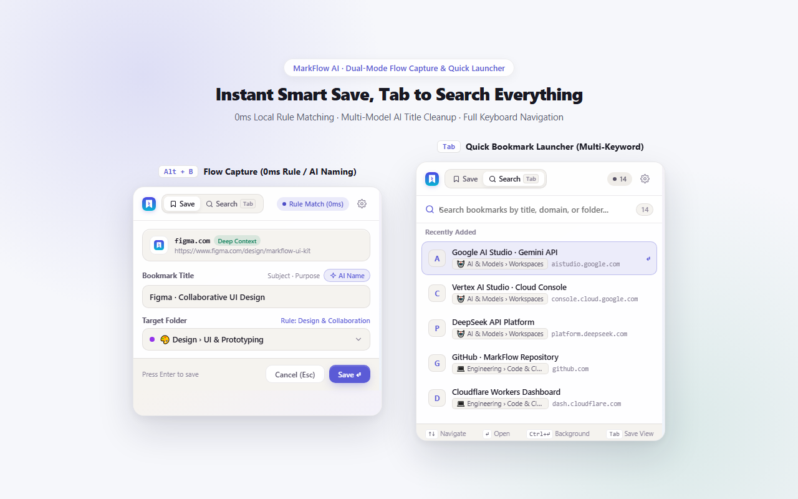
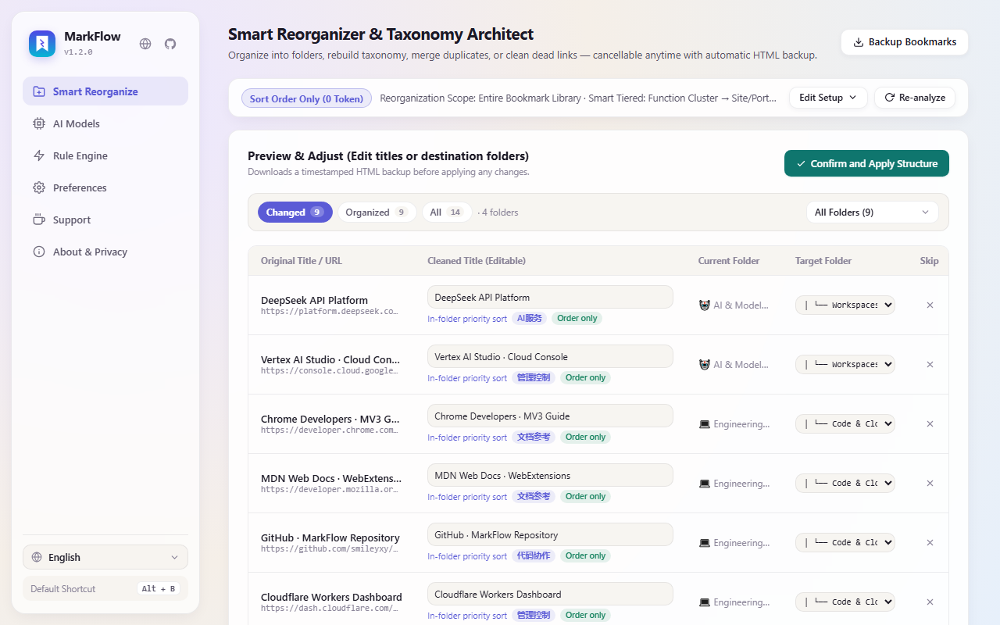
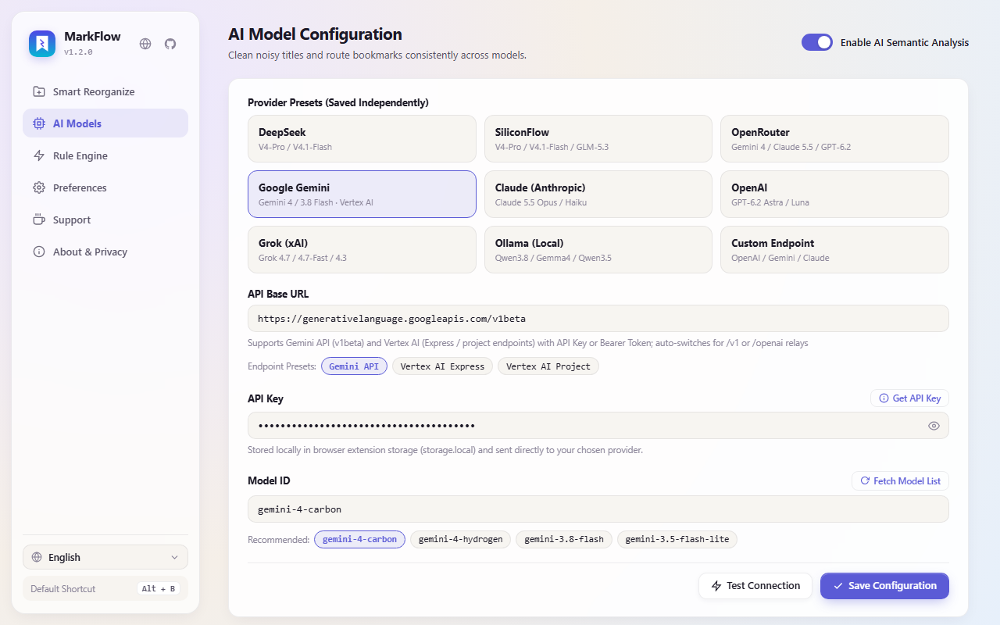
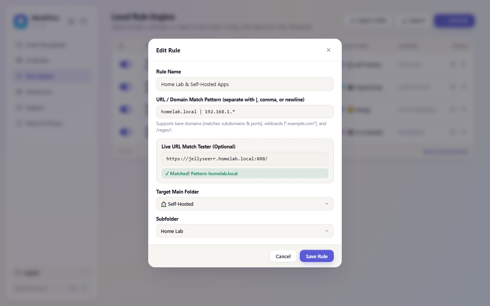
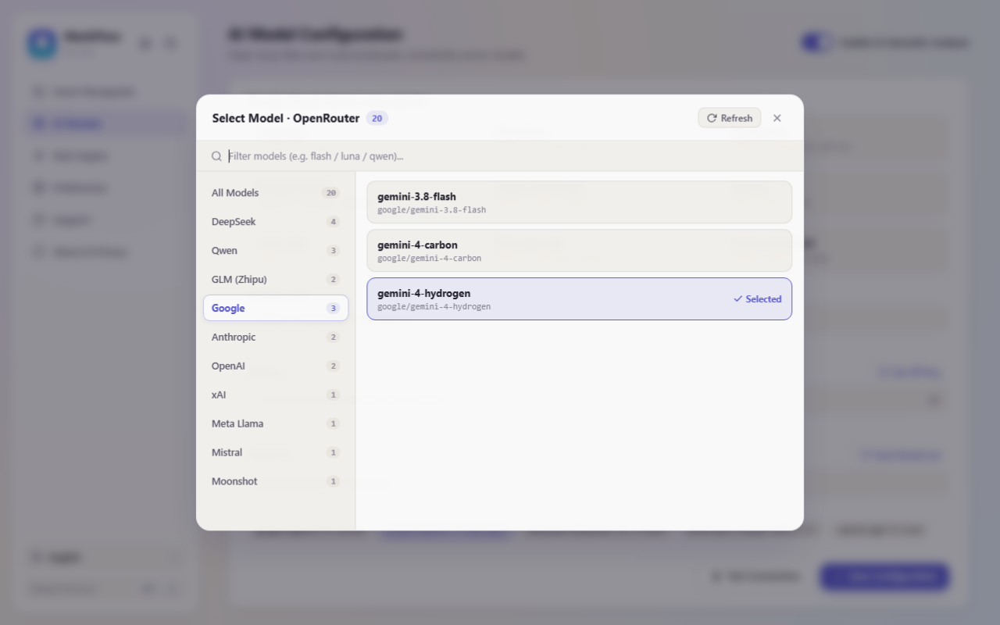

<div align="center">


# MarkFlow AI

**Local Rule Engine + Multi-Model AI Semantic Bookmark Organizer, Sorter & Quick Launcher**

**English** · **[简体中文](README.zh-CN.md)**

[](https://markflow.smileyxy.dpdns.org/)
[](https://chromewebstore.google.com/detail/iclflcfabddfogenahenikehdnpbhjgm)
[](https://microsoftedge.microsoft.com/addons/detail/gnobhgjnibpaoibjjpnghfmodpkokgll)
[](LICENSE)
[](manifest.json)
[](#project-structure)
[](#multi-language-support)

[Website](https://markflow.smileyxy.dpdns.org/) · [Screenshots](#-screenshots) · [Features](#-core-features) · [Installation](#-installation) · [AI Providers](#-supported-ai-providers) · [Shortcuts](#-keyboard-shortcuts) · [Privacy](#-privacy--local-first-architecture) · [License](#-license)

</div>

---

## ✨ Why MarkFlow AI?

Browser bookmark bars quickly turn into unsearchable clutter: bloated SEO page titles, scattered duplicate links, and inconsistent folders.

**MarkFlow AI** combines a **0ms Local Rule Engine**, **Multi-Model AI Semantic Classification**, and **Local Domain Affinity Memory** — keeping all your bookmarks natively inside Chrome while turning every save and library cleanup into an effortless, keyboard-first flow:

- ⚡ **0ms Deterministic Routing**: Frequent domains, self-hosted homelab services, and docs match locally in zero milliseconds without spending AI tokens.
- 🧠 **Consistent Naming & Filing**: Strips noisy SEO suffixes into clean scannable titles and picks the best matching subfolder from your existing tree.
- 🗂️ **Safe, Controllable Bulk Cleanup**: Reorganize inside existing folders with 3-tier priority sorting, or design and edit a two-level folder blueprint before migrating — backed up automatically as standard HTML.
- 🔍 **Instant Keyboard Bookmark Launcher**: Press `Alt + B` anywhere, hit `Tab` (or open on a New Tab), type multiple keywords, and jump right to any bookmark.

---

## 🖼️ Screenshots

### Flow Capture Popup & Instant Bookmark Launcher
<p align="center">
  
</p>

### Smart Reorganizer & 3-Tier In-Folder Priority Sorting
<p align="center">
  
</p>

<table>
  <tr>
    <td width="50%">
      <p align="center"><strong>Multi-Model AI &amp; Vertex AI Configuration</strong></p>
      
    </td>
    <td width="50%">
      <p align="center"><strong>Local Rule Engine &amp; Live URL Tester</strong></p>
      
    </td>
  </tr>
</table>

### Master-Detail Model Picker (Vendor &amp; Family Normalization)
<p align="center">
  
</p>

---

## 🚀 Core Features

### 1. Smart Reorganizer, Library Cleaner & Taxonomy Architect
- **Stage-Focused Workspace, Multi-Folder Scope & Mid-Run Cancel**: Entering Blueprint or Preview automatically collapses the configuration panel into a single-line summary bar (expandable inline anytime) paired with a compact unified status strip — showing more bookmarks above the fold. When scoping by folder, a **tree-indented multi-folder selector** lets you target multiple folders at once (automatically folding included subfolders and deduplicating overlapping selections). Every long-running AI task or dead-link scan can be canceled mid-flight with `AbortController`, preserving completed batch results while letting you resume unprocessed items later.
- **Fit Existing Folders & Sort**: Preserves your familiar folders while cleaning titles, relocating misplaced links, and sorting inside each folder with **5 sort rules** (*Smart Priority Tiered*, *Site Domain & Port*, *Title A → Z*, *Newest First*, *Oldest First*), filtered views (*All Changes* / *Organized* / *AI Failed* / *Unprocessed* / *All*), and a **compact single-row preview table** with domain ellipsis.
- **0-Token Duplicate Merge & Dead Link Cleanup**:
  - **Duplicate Bookmark Merge**: Pure local URL canonicalization (strips tracking query params like `utm_*`/`spm`/`fbclid`/`vd_source`, normalizes protocol/`www`/trailing slashes, preserves `#hash` by default) with smart deepest-folder/earliest retention, per-group override, and automatic cleanup of emptied folders.
  - **Dead Link Cleanup**: Automatically skips non-HTTP and private/LAN URLs, supports on-demand temporary host access (immediately revoked after scan/cancel, with `no-cors` fallback if declined), interleaves probes across hosts to avoid per-site burst throttling, verifies `HEAD` failures with HTML `GET`, runs a low-concurrency 22s `GET` second pass on initial timeouts to rescue slow-loading sites while exposing stalled/unreachable hosts, cross-checks bare-domain HTTPS and manual HTTP hosts to separate genuine dead links (`404`/`410`/unreachable, checked by default) from TLS certificate warnings/persistent timeouts/`HTTP 444`/Cloudflare `521`/`5xx` (unchecked for manual review), surfaces zero-extra-request local proxy/network anomaly warnings if multiple global bookmark sites or a high ratio fail, and automatically filters out WAF JS-challenge `521`/auth/rate-limit shields (`401`/`403`/`412`/`429`).
- **0-Token Quick Sort**: Reorder bookmarks inside existing folders purely locally using your chosen sort rule without any AI calls.
- **Resilient Partial Retry**: If any batch encounters upstream quota/network errors during reorganization, failed bookmarks stay separated from succeeded items with a one-click **`Retry Failed (N)`** action and dedicated filter tab so already-succeeded batches never re-spend tokens.
- **Two-Stage Full Rebuild**:
  1. **Blueprint Review**: AI proposes a two-level folder hierarchy with **5 visual folder styles** (Semantic Icons, Dual Icons, Plain Text, Numbered `01`, Minimal Symbol `◆`) where you can lock existing folders cleanly in a multi-select popover, rename nodes, or add/remove subfolders;
  2. **Atomic Migration**: Bulk-maps bookmarks (with a real-time **local Token Estimator** before running), folds single-item orphan subfolders, sorts every destination folder, and safely removes empty legacy folders.
- **Dual Backup Safety**: Export a standard Netscape HTML backup anytime with one click, plus automatic timestamped HTML backup downloads before applying any bulk changes or deletions.

### 2. Local Rule Engine
- Matches by **bare domain** (automatically handles nested subdomains and custom ports), **wildcards** (`*github.com*`), or **regular expressions** (`/docs\..+\.dev/i`), supporting multiple separators (`|`, commas, newlines).
- Includes a built-in **Live URL Match Tester** inside the rule modal to verify exact rule hits in real time.
- Optional toggle to pair 0ms rule folder routing with lightweight AI title cleanup.

### 3. Flow-State Capture, Resilient Retry & Quick Launcher
- Press `Alt + B` on any page to inspect/edit the cleaned title and suggested subfolder, or hit `Enter` to save immediately.
- If an AI call fails (quota, auth, rate limit, or timeout), the popup automatically pauses the auto-save countdown and surfaces a **compact failure strip** with a one-click **Retry**, expandable error excerpt, and **AI Settings** shortcut — backed by friendly sanitized notifications across the entire UI.
- Triggering the popup on a New Tab opens directly in **Search Mode**; press `Tab` anytime to toggle between Save and Search with multi-keyword fuzzy matching and keyboard navigation.
- Configurable **Auto-Save Countdown**, **CJK-Latin spacing (Pangu)**, **3 Title Styles**, **Custom AI Instructions**, and full JSON settings export/import.

### 4. Multi-Language Support
Full localized UI & extension metadata across **7 languages**:

`English` · `简体中文` · `繁體中文 (台灣 / 香港 / 澳門)` · `日本語` · `한국어` · `Deutsch` · `Español`

---

## 🤖 Supported AI Providers

Each provider stores its Base URL, credential, and model ID independently, includes a **one-click API Key link + collapsible setup guide**, and supports live `/models` fetching inside a centered **Master-Detail Model Picker** featuring normalized vendor badges (`Pro` / `Free` / `LoRA` / `Preview` / `Reasoning`), dynamic generation grouping, live search, and Vertex AI custom `:countTokens` verification:

| Provider | Protocol | Recommended Models | Notes |
| :--- | :--- | :--- | :--- |
| **DeepSeek** | OpenAI Compatible | `deepseek-v4-pro` / `deepseek-flash` | Default preset; fast technical & multilingual classification |
| **SiliconFlow** | OpenAI Compatible | `DeepSeek-V4.1-Flash` / `GLM-5.3-Flash` / `Qwen3.5-35B-A3B` | Fast OpenAI-compatible hosting across DeepSeek V4, GLM-5.3 & Qwen3.5 |
| **OpenRouter** | OpenAI Compatible | `google/gemini-4-hydrogen` / `deepseek/deepseek-v4.1-flash` / `anthropic/claude-haiku-5.5` | Unified gateway across 100+ models grouped by normalized vendor |
| **Google Gemini & Vertex AI** | Gemini `v1beta` · Vertex AI Express · Vertex AI Project | `gemini-4-carbon` / `gemini-4-hydrogen` / `gemini-3.8-flash` | Presets for Gemini API & Vertex AI with automatic Gemini 4 `locations/global` routing, free `:countTokens` probing, custom model verification & opt-in **Vertex AI Priority PayGo** mode |
| **Claude (Anthropic)** | Anthropic Messages (`/v1/messages`) | `claude-opus-5-5` / `claude-haiku-5-5` / `claude-sonnet-5-5` | Native browser-direct CORS Messages API support |
| **OpenAI** | OpenAI Compatible | `gpt-6.2-astra` / `gpt-6.2-sol` / `gpt-6-luna` | Standard global OpenAI endpoint |
| **Grok (xAI)** | OpenAI Compatible | `grok-4.7` / `grok-4.7-fast` / `grok-4.3` | Official xAI API endpoint |
| **Ollama (Local)** | Local OpenAI Compatible | `qwen3.8:27b` / `gemma4:12b` / `qwen3.5:9b` | 100% offline local inference, no API Key & zero token cost |
| **Custom Endpoint** | OpenAI / Anthropic / Gemini / Vertex | Any Model ID | Supports self-hosted gateways, enterprise proxies, or custom relays |

---

## ⚡ Installation

### Option 1: Chrome Web Store / Microsoft Edge Add-ons (Recommended)
Install directly with automatic updates from the official extension stores:

👉 **[Install MarkFlow AI from Chrome Web Store](https://chromewebstore.google.com/detail/iclflcfabddfogenahenikehdnpbhjgm)** · **[Install from Microsoft Edge Add-ons](https://microsoftedge.microsoft.com/addons/detail/gnobhgjnibpaoibjjpnghfmodpkokgll)** · **[Official Website](https://markflow.smileyxy.dpdns.org/)**

### Option 2: GitHub Releases
1. Download the latest `markflow-v*.zip` from [GitHub Releases](https://github.com/smileyxy/markflow/releases) and extract it locally.
2. Open `chrome://extensions/` and enable **Developer mode**.
3. Click **Load unpacked** and select the extracted folder.

### Option 3: Load Unpacked from Source
**Zero-build native Manifest V3 architecture** — no Node.js or bundler required:

```bash
git clone https://github.com/smileyxy/markflow.git
```

Enable **Developer mode** at `chrome://extensions/` and click **Load unpacked** on the cloned repository folder.

---

## ⌨️ Keyboard Shortcuts

| Shortcut | Context | Action |
| :--- | :--- | :--- |
| `Alt + B` | Any Webpage / New Tab | Open MarkFlow popup (customizable at `chrome://extensions/shortcuts`) |
| `Tab` | Inside Popup | Toggle between Save Mode and Quick Search Launcher |
| `↑` / `↓` | Search Mode | Move highlight across matched bookmarks |
| `Enter` | Save / Search Mode | Confirm save / open highlighted bookmark (`Ctrl+Enter` opens in background tab) |
| `Esc` | Popup / Options Modals | Close current overlay, lightbox preview, or dropdown |

---

## 🔒 Privacy & Local-First Architecture

MarkFlow AI is designed strictly **Local-First & Zero-Server**, adhering to Chrome Web Store and Microsoft Edge Add-ons Privacy and Limited Use policies (see [PRIVACY.md](PRIVACY.md) or [Online Privacy Policy](https://markflow.smileyxy.dpdns.org/privacy)):

- **Zero Servers & Zero Telemetry**: No developer backend, no accounts, and no analytics/tracking SDKs. Bookmarks stay in your browser's native bookmark tree with standard browser Sync compatibility.
- **Keys Stay Local**: API keys are stored solely in your browser's `chrome.storage.local` and sent directly to your configured AI endpoint or local Ollama instance.
- **Minimal On-Demand Permissions**: Installs with **zero required `host_permissions`**. Page metadata is only read when you deliberately trigger bookmark capture (and can be disabled anytime in **Preferences**). `optional_host_permissions` covers strictly opt-in actions: (1) official Vertex AI endpoints (`aiplatform.googleapis.com` / `us-aiplatform.googleapis.com` / `eu-aiplatform.googleapis.com`) requested one host at a time when enabling **Vertex AI Priority** mode, and (2) temporary `https://*/*` / `http://*/*` access requested solely during **Dead Link Scan** (sending credential-free local `HEAD`/`GET` probes and auto-revoked via `chrome.permissions.remove` immediately upon completion or cancellation).

---

## 📁 Project Structure

```text
markflow/
├── manifest.json             # Manifest V3 manifest & minimal permissions
├── _locales/                 # Chrome Web Store & extension metadata for 7 locales
├── background/
│   └── service-worker.js     # Lifecycle defaults & storage initialization
├── shared/                   # Zero-dependency modular core engine
│   ├── constants.js          # Provider presets, multi-topic domains, default rules
│   ├── platform.js           # Chromium / Edge root-folder compatibility adapter
│   ├── utils.js              # Title cleaner, Pangu spacing, helpers
│   ├── tree.js               # Bookmark tree analyzer & blueprint orphan folding
│   ├── rules.js              # Local rule engine (domain / wildcard / regex)
│   ├── sorter.js             # 3-tier priority sorter & deterministic insertion index
│   ├── cleaner.js            # 0-Token URL dedup & cancellable dead link scanner
│   ├── llm.js                # Unified Gemini API / Vertex AI / OpenAI client
│   ├── classifier.js         # Single & batch semantic classification orchestrator
│   ├── i18n.js               # Dynamic 7-language i18n runtime
│   └── locales/              # 7 standalone locale dictionaries
├── popup/                    # Flow capture popup & keyboard bookmark launcher
├── options/                  # Settings & Smart Reorganizer dashboard
│   └── guide/                # Offline quick-start guide screenshots
├── docs/screenshots/         # Bilingual README & Store showcase screenshots
├── icons/                    # Extension icons
├── PRIVACY.md                # Privacy policy
├── CHANGELOG.md              # Release notes
├── README.zh-CN.md           # Chinese README
└── LICENSE                   # GNU GPL-3.0 License
```

---

## 📄 License

This project is open source under the **[GNU General Public License v3.0 (GPL-3.0)](LICENSE)**.
