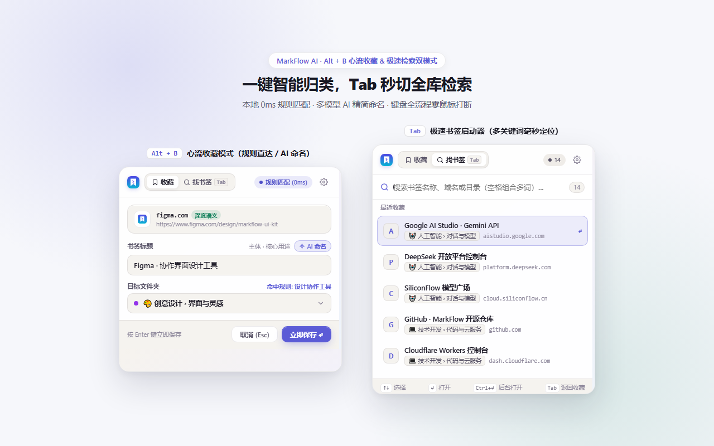
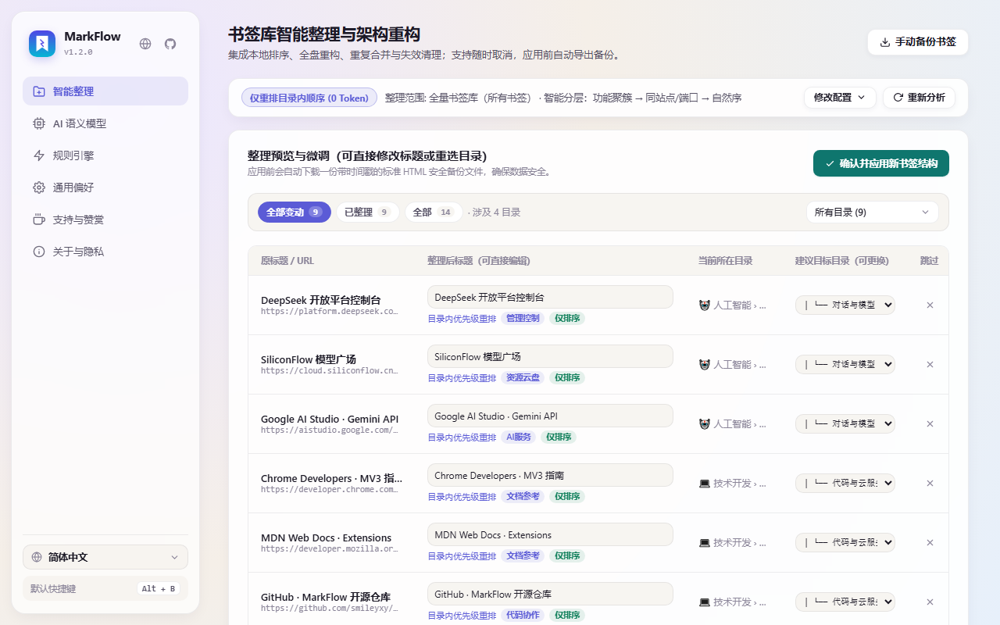
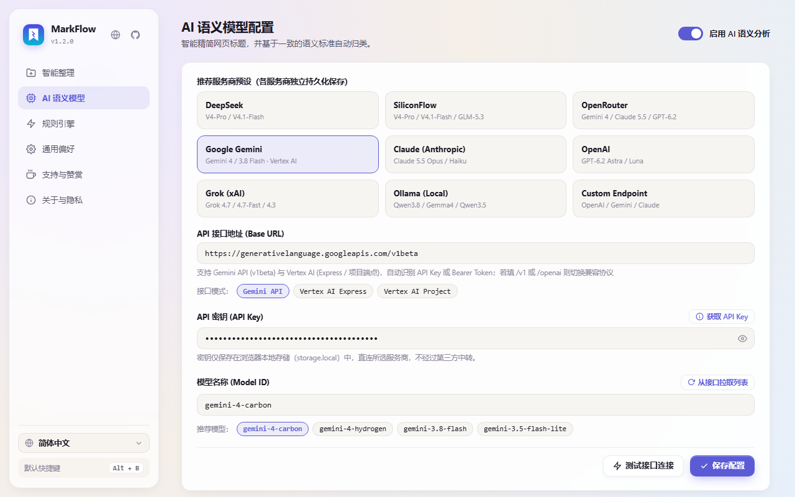
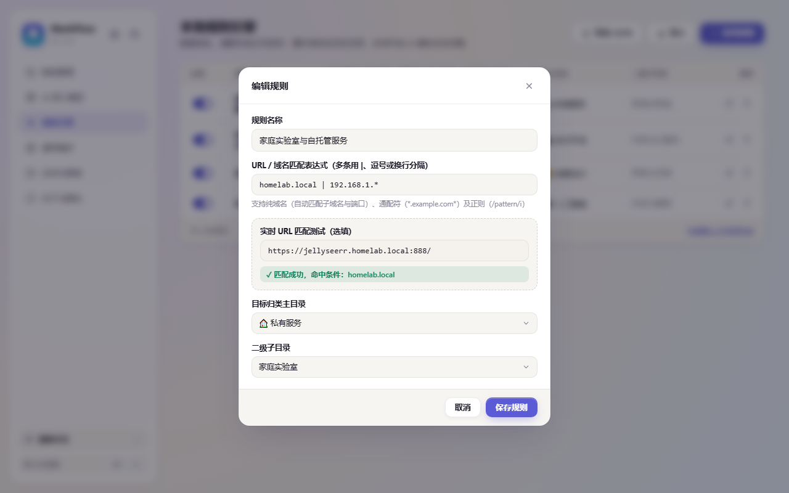
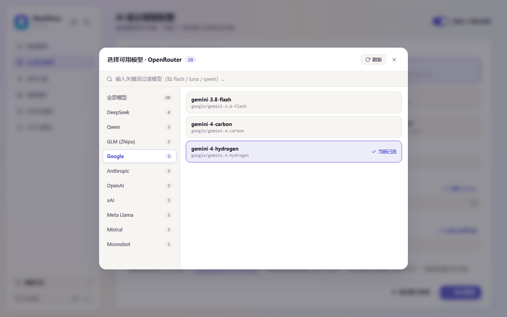

<div align="center">


# MarkFlow AI

**面向心流体验的本地规则 + 多模型 AI 书签自动归类、智能整理与极速检索扩展**

**[English](README.md)** · **简体中文**

[](https://markflow.smileyxy.dpdns.org/)
[](https://chromewebstore.google.com/detail/iclflcfabddfogenahenikehdnpbhjgm)
[](https://microsoftedge.microsoft.com/addons/detail/gnobhgjnibpaoibjjpnghfmodpkokgll)
[](LICENSE)
[](manifest.json)
[](#项目结构)
[](#多语言支持)

[官方网站](https://markflow.smileyxy.dpdns.org/) · [界面预览](#-界面预览) · [核心能力](#-核心能力) · [安装方式](#-安装方式) · [支持的 AI 模型](#-支持的-ai-服务商) · [快捷键](#-快捷键速查) · [隐私保护](#-隐私保护与纯本地架构) · [开源协议](#-开源协议)

</div>

---

## ✨ 为什么选择 MarkFlow AI？

传统的浏览器书签栏往往随着时间演变为难以检索的「收藏夹黑洞」：冗长的 SEO 网页标题、散落各处的重复链接、杂乱无章的层级目录，让收藏失去了复用的意义。

**MarkFlow AI** 采用 **「0ms 本地规则引擎 + 多模型 AI 语义分析 + 本地域名亲和记忆」** 混合架构，在不改变你使用 Chrome 原生书签习惯的前提下，将每一次收藏与全库整理变成轻松顺滑的心流体验：

- ⚡ **毫秒级规则直达**：常用域名、自托管内网服务或开发文档，直接由本地规则 0ms 锁定目录，零 Token 消耗。
- 🧠 **跨模型一致命名与归类**：长篇 SEO 标题自动清洗为易扫视的精炼标题，并依据现有书签树上下文推荐最合适的二级目录。
- 🗂️ **可控的存量书签整理**：既可保留现有目录结构并按优先级重排内部顺序，也可先审阅/编辑蓝图再全盘重构两级体系，落地前自动导出标准 HTML 安全备份。
- 🔍 **极速键盘书签启动器**：在任意页面或新标签页按下 `Alt + B`，`Tab` 一键切入本地模糊搜索，键盘上下选择、回车即达。

---

## 🖼️ 界面预览

### 心流收藏浮窗 & 极速书签启动器
<p align="center">
  
</p>

### 书签库智能整理与 3 级优先级排序
<p align="center">
  
</p>

<table>
  <tr>
    <td width="50%">
      <p align="center"><strong>多模型 AI &amp; Vertex AI 配置</strong></p>
      
    </td>
    <td width="50%">
      <p align="center"><strong>本地规则引擎与实时 URL 测试器</strong></p>
      
    </td>
  </tr>
</table>

### 主从分栏模型选择器（厂商与代际自动归一化）
<p align="center">
  
</p>

---

## 🚀 核心能力

### 1. 智能整理、书签库清理与目录架构重构
- **阶段聚焦工作台、树形多选范围 & 随时取消**：进入蓝图或预览阶段后，顶部配置卡片自动折叠为单行摘要条（随时可展开微调），并将指标、筛选与失败重试收口为紧凑单条状态栏，首屏露出更多待审书签；按文件夹局部整理时可通过**树形缩进多选浮层**一次勾选多个目标目录（自动包含下级子目录并按书签 ID 去重）；所有 AI 整理、重试及失效扫描均支持 `AbortController` 随时秒停，并保留已完成批次结果以便稍后继续。
- **归入现有目录 & 多规则排序**：保留你熟悉的文件夹骨架，批量清洗标题、纠偏错位书签，支持 **5 种排序规则**（*智能分层聚簇*、*站点域名与端口分组*、*标题 A → Z 升序*、*最新优先*、*最早优先*），支持按 `全部变动 / 已整理 / AI 失败 / 未处理 / 全部` 分离筛选，并采用全宽输入框与单行省略预览表格。
- **0 Token 重复合并 & 失效链接清理**：
  - **重复书签合并**：纯本地 URL 规范化（剔除 `utm_*` / `spm` / `fbclid` / `vd_source` 等追踪参数、统一协议/`www`/斜杠、默认保留 `#锚点` 区分文档章节），按深层归类与收藏时间智能推荐保留项，支持逐组切换保留副本并自动清理删空旧目录。
  - **失效链接清理**：默认跳过内网与非 HTTP(S) 书签，扫描前按需申请临时域名权限并在完成或取消后立即自动撤销（拒绝授权可降级为零权限 `no-cors` 连通性探测）；按域名轮询打散并发防止同站扎堆触发防爬，对 `HEAD` 异常自动使用 HTML `GET` 二次核验，对首轮超时链接自动触发低并发（2 并发 + 22s）`GET` 复测救回慢加载活站并捕获深层失联主机，同时补测裸域 HTTPS 与 HTTP 在线状态并自动过滤 `401`/`403`/`412`/`429` 及非 Cloudflare WAF JS 质询（如 CSDN `HTTP 521`）；扫描结束时基于自身结果零外发识别代理或网络异常并给出顶部提示，精准分离「高置信失效（`404`/`410`/真死链，默认勾选）」与「需人工复核（TLS 证书异常/`HTTP 444`/Cloudflare `521`/`5xx`/两轮超时，默认不勾选 + 一键打开验证）」。
- **0 Token 极速纯重排**：不消耗任何 AI 额度，直接按选定排序规则对现有目录完成本地顺序整理。
- **失败分离筛选与「仅重试失败项」**：批量整理遇到限流或网络波动时，失败书签与成功整理项彻底拆清统计，支持点击失败胶囊单独筛选，并一键 **`↻ 仅重试失败项 (N)`**（或继续未处理项），避免对已成功批次重复消耗 Token。
- **两阶段全盘目录重构**：
  1. **蓝图设计阶段**：AI 分析全量书签分布并生成两级目录草案，支持 **5 种视觉前缀风格**（单层图标、双层图标、纯文字、数字编号 `01`、几何符号 `◆`），可通过轻量多选浮层锁定现有目录或自由微调节点；
  2. **原子落地阶段**：运行前提供本地 **0 请求 Token 估算**；确认后批量映射归位、自动收拢孤岛子目录、按规则排序并清理迁空旧目录。
- **双重安全兜底**：控制台顶部随时可「手动备份书签」，且每次确认应用整理或清理删除前均自动下载带时间戳的标准 Netscape HTML 备份文件。

### 2. 本地智能规则引擎
- 支持 **纯域名**（如 `homelab.local`，自动兼容多级子域名与自定义端口）、**通配符**（`*github.com*`）、**正则表达式**（`/docs\..+\.dev/i`），并支持用 `|`、全角 `｜`、逗号或换行分隔多条匹配条件。
- 规则编辑弹窗内置 **实时 URL 匹配测试器**，粘贴任意网址即可即时验证命中状态与命中片段。
- 支持自由开关 **「命中本地规则时仍用 AI 命名标题」**，在 0ms 精准锁定目录与高质量标题清洗之间按需权衡。

### 3. 心流收藏弹窗、失败重试与极速启动器
- 任意网页按 `Alt + B` 立即弹出收藏浮窗，展示清洗后的推荐标题与二级目录路径，支持一键 AI 重新命名或新建子目录。
- 当 AI 调用遭遇配额、鉴权、限流或超时异常时，弹窗自动暂停保存倒计时，并展现紧凑的**失败提示条**（支持一键 **重试**、展开脱敏错误详情与直达 **配置** 页面）；控制台同步对长错误信息进行友好收敛与防溢出处理。
- 在新标签页唤醒扩展时自动切入 **检索模式**；按 `Tab` 可在收藏/检索之间瞬间切换，输入关键词即可毫秒级过滤全部历史书签。
- 支持可选的 **自动保存倒计时**、**盘古之白（中英文自动空格）**、**标题风格切换（扫视型 / 极简短名 / 保真精简）** 与 **自定义 AI 补充说明**。

### 4. 多语言支持
完整适配 **7 种界面语言**（涵盖 Chrome 扩展元数据 `_locales/`、弹窗与控制台全部界面）：

`简体中文` · `繁體中文（台灣 / 香港 / 澳門）` · `English` · `日本語` · `한국어` · `Deutsch` · `Español`

---

## 🤖 支持的 AI 服务商

所有服务商的端点、密钥与模型均 **独立持久化保存**，内置**一键官方密钥获取入口与可折叠分步指引**，并支持在**主从分栏模型选择器**中一键拉取实时 `/models` 列表、归一化厂商标签（`Pro` / `Free` / `LoRA` / `Preview` / `Reasoning`）及按代际动态折叠筛选：

| 服务商 | 接口协议 | 典型推荐模型 | 说明 |
| :--- | :--- | :--- | :--- |
| **DeepSeek** | OpenAI Compatible | `deepseek-v4-pro` / `deepseek-flash` | 默认推荐服务商，中文技术与多语言语义分类稳定 |
| **SiliconFlow (硅基流动)** | OpenAI Compatible | `DeepSeek-V4.1-Flash` / `GLM-5.3-Flash` / `Qwen3.5-35B-A3B` | 国内直连高速响应，覆盖 DeepSeek V4、GLM-5.3 与 Qwen3.5 系列 |
| **OpenRouter** | OpenAI Compatible | `google/gemini-4-hydrogen` / `deepseek/deepseek-v4.1-flash` / `anthropic/claude-haiku-5.5` | 聚合 100+ 顶级模型，弹窗列表自动归一化厂商分组 |
| **Google Gemini & Vertex AI** | Gemini `v1beta` · Vertex AI Express · Vertex AI 项目端点 | `gemini-4-carbon` / `gemini-4-hydrogen` / `gemini-3.8-flash` | 内置 **Gemini API** 与 **Vertex AI** 预设，支持 Gemini 4 自动 `locations/global` 全局路由、免费 `:countTokens` 模型探测及可选 **Vertex AI Priority PayGo** 优先模式 |
| **Claude (Anthropic)** | Anthropic Messages (`/v1/messages`) | `claude-opus-5-5` / `claude-haiku-5-5` / `claude-sonnet-5-5` | 原生支持 Anthropic Messages 接口与浏览器直连 CORS 头 |
| **OpenAI** | OpenAI Compatible | `gpt-6.2-astra` / `gpt-6.2-sol` / `gpt-6-luna` | 全球通用高稳定端点 |
| **Grok (xAI)** | OpenAI Compatible | `grok-4.7` / `grok-4.7-fast` / `grok-4.3` | 官方 xAI 接口直连支持 |
| **Ollama (Local)** | Local OpenAI Compatible | `qwen3.8:27b` / `gemma4:12b` / `qwen3.5:9b` | 100% 本地离线运行，无需 API Key，零 Token 费用 |
| **Custom Endpoint** | OpenAI / Anthropic / Gemini / Vertex | 任意自定义模型 ID | 兼容自建中转、企业内网网关或任意第三方代理端点 |

---

## ⚡ 安装方式

### 方式一：从浏览器应用商店安装（推荐）
直接从 Chrome / Microsoft Edge 官方商店一键安装，支持后续自动更新：

👉 **[前往 Chrome Web Store 安装](https://chromewebstore.google.com/detail/iclflcfabddfogenahenikehdnpbhjgm)** · **[前往 Microsoft Edge Add-ons 安装](https://microsoftedge.microsoft.com/addons/detail/gnobhgjnibpaoibjjpnghfmodpkokgll)** · **[访问官方网站](https://markflow.smileyxy.dpdns.org/)**

### 方式二：从 GitHub Releases 下载安装
1. 前往 [Releases 页面](https://github.com/smileyxy/markflow/releases) 下载最新版本的 `markflow-v*.zip` 并解压到本地目录；
2. 打开 Chrome / Edge / Brave 地址栏访问 `chrome://extensions/`，开启右上角 **「开发者模式」**；
3. 点击 **「加载已解压的扩展程序」**，选择刚刚解压的文件夹即可使用。

### 方式三：克隆源码本地体验
本项目采用 **纯原生 Manifest V3 零构建架构**，无需安装 Node.js 或任何构建工具：

```bash
git clone https://github.com/smileyxy/markflow.git
```

在 `chrome://extensions/` 中开启开发者模式并加载克隆后的项目根目录即可直接运行。

---

## ⌨️ 快捷键速查

| 快捷键 | 作用域 | 功能说明 |
| :--- | :--- | :--- |
| `Alt + B` | 全局网页 / 新标签页 | 唤醒 MarkFlow 浮窗（在 `chrome://extensions/shortcuts` 可自定义） |
| `Tab` | 扩展弹窗内 | 在「收藏当前页」与「极速书签检索」模式间切换 |
| `↑` / `↓` | 检索模式下 | 上下移动高亮选中的历史书签 |
| `Enter` | 收藏 / 检索模式 | 确认保存当前书签 / 在新标签页打开高亮书签（`Ctrl+Enter` 后台打开） |
| `Esc` | 扩展弹窗 / 控制台弹窗 | 关闭当前弹层、灯箱预览或下拉菜单 |

---

## 🔒 隐私保护与纯本地架构

MarkFlow AI 坚持 **Local-First & Zero-Server** 原则，严格遵循 Chrome Web Store 与 Microsoft Edge Add-ons 隐私与 Limited Use 政策（详见 [PRIVACY.md](PRIVACY.md) 或 [在线隐私政策](https://markflow.smileyxy.dpdns.org/privacy)）：

- **零云端中转与遥测**：无任何自建后端、账号体系或第三方埋点，书签数据原生托管于浏览器并兼容浏览器自带云端同步。
- **密钥仅存本地**：API Key 仅保存在本机 `chrome.storage.local`，请求由浏览器直连你所指定的 AI 服务商或本地 Ollama 实例。
- **最小权限与按需提取**：安装时申请**零条强制 `host_permissions`**；仅在你主动触发收藏时按需读取当前页标题与摘要（可在「通用偏好」中一键关闭页面正文读取）。`optional_host_permissions` 严格用于两类按需操作：(1) 仅在开启 **Vertex AI Priority** 模式时按当前端点逐个申请官方域名（`aiplatform.googleapis.com` / `us-aiplatform.googleapis.com` / `eu-aiplatform.googleapis.com`），关闭即自动回收；(2) 仅在主动启动 **失效链接清理** 扫描时临时申请 `https://*/*` 与 `http://*/*` 发送不带 Cookie 的本地 `HEAD`/`GET` 连通性探测，并在扫描结束或取消瞬间立即调用 `chrome.permissions.remove` 自动撤销。

---

## 📁 项目结构

```text
markflow/
├── manifest.json             # Manifest V3 扩展清单与最小权限声明
├── _locales/                 # Chrome 扩展名称与描述 7 国语言包
├── background/
│   └── service-worker.js     # 扩展生命周期初始化与默认配置引导
├── shared/                   # 核心引擎模块化层（无框架依赖）
│   ├── constants.js          # 服务商预设、多主题站点白名单与默认规则常量
│   ├── platform.js           # Chromium / Edge 跨浏览器目录与本地化适配
│   ├── utils.js              # 标题清洗、盘古之白与通用辅助工具
│   ├── tree.js               # 书签树拓扑分析、蓝图构建与孤岛子目录收敛
│   ├── rules.js              # 本地规则引擎（域名/通配符/正则实时匹配）
│   ├── sorter.js             # 目录内 3 级优先级排序与增量插入位置计算
│   ├── cleaner.js            # 0 Token 重复合并与可中止失效链接探测引擎
│   ├── llm.js                # Gemini API / Vertex AI / OpenAI 统一通信适配层
│   ├── classifier.js         # 单条收藏与批量整理核心归类调度器
│   ├── i18n.js               # 7 语种动态翻译与 DOM 自动注入
│   └── locales/              # 7 个独立语言词典文件
├── popup/                    # 心流收藏弹窗 & 极速键盘书签启动器
├── options/                  # 控制台页面（智能整理 / AI / 规则 / 偏好 / 赞赏 / 关于）
│   └── guide/                # 关于页 3 步快速上手离线实景缩略图
├── docs/screenshots/         # 中英文 README 与商店实景预览图
├── icons/                    # 扩展图标资源
├── PRIVACY.md                # 隐私政策说明
├── CHANGELOG.md              # 版本变更记录
├── README.md                 # 英文说明文档（默认）
└── LICENSE                   # GNU GPL-3.0 开源协议
```

---

## 📄 开源协议

本项目基于 **[GNU General Public License v3.0 (GPL-3.0)](LICENSE)** 协议开源。

你可以自由使用、学习、修改与分发本项目代码；若你基于本项目发布衍生作品，须同样以 GPL-3.0 协议开放源代码并保留原始版权声明。
